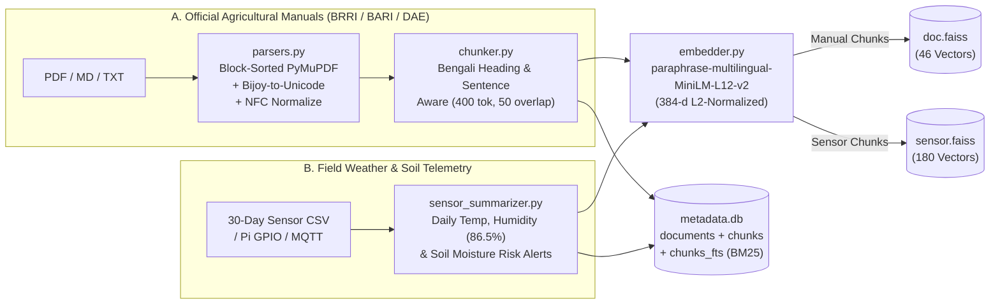
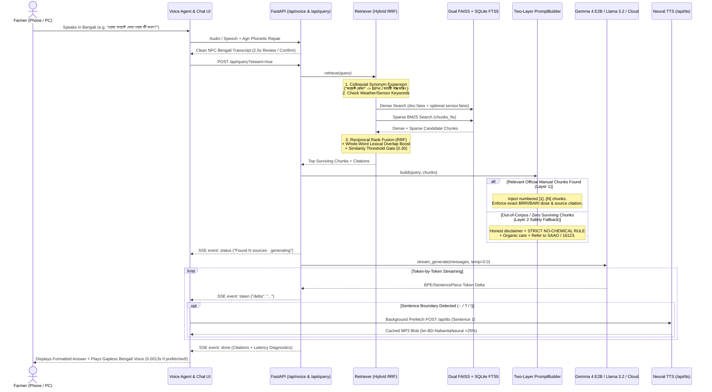
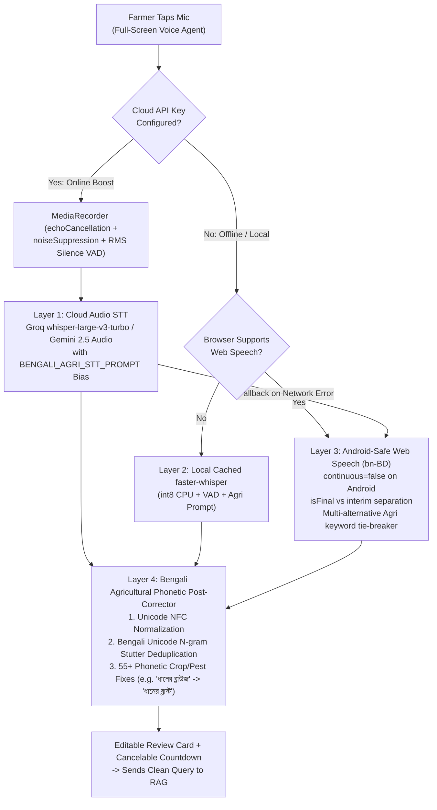
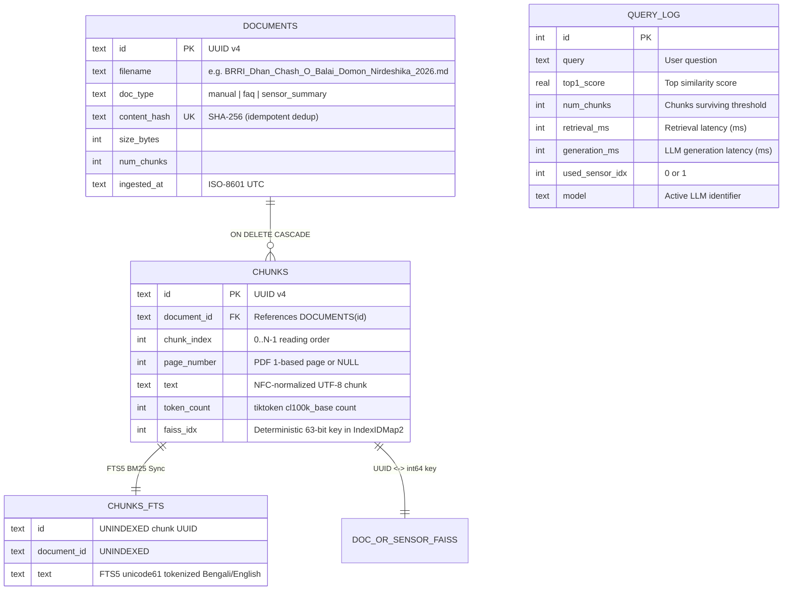

# TinyRAG (AgriRAG) — Complete System Architecture & Codebase Guide

> **Course:** CSE 600 Capstone Project (Group 14), Department of CSE, University of Chittagong  
> **Supervisor:** Dr. Abu Nowshed Chy, Associate Professor, Dept. of CSE, CU  
> **Core Engine:** `TinyRAG` (Offline-First Edge IoT RAG Framework)  
> **Domain Specialization:** `AgriRAG` (Voice-to-Voice Bengali Agricultural & Agro-Meteorological Advisory System)

---

## 1. Executive Summary (At a Glance for Defense / Review)

**TinyRAG** is a modular, privacy-preserving, **100% offline-capable Retrieval-Augmented Generation (RAG)** system engineered for CPU-only Edge IoT devices (such as a **Raspberry Pi 5** or budget laptop without a GPU). Its flagship specialization, **AgriRAG**, turns official Bangladeshi agricultural manuals (**BRRI, BARI, DAE**) and field **IoT weather/soil telemetry** into a safe, citation-grounded **Bengali voice-to-voice assistant** for smallholder farmers.

| Core Engineering Pillar | How TinyRAG Solves It |
| :--- | :--- |
| **1. Strict Architectural Decoupling** | **6 Unidirectional Layers** + Python `typing.Protocol` interfaces (`LLMClient`, `EmbeddingModel`, `VectorStore`, `MetadataAccessor`, `SensorSource`). Domain logic (`core/`) has **zero direct I/O**. |
| **2. Dual-Hybrid Bengali Retrieval** | **Colloquial Farmer Dialect Expansion** (*"কারেন্ট পোকা"* $\rightarrow$ *BPH*) + **384-d Multilingual Dense FAISS** + **SQLite FTS5 BM25 Sparse Search** + **Reciprocal Rank Fusion (RRF)** + **Whole-Word Lexical Boost** (`100%` Recall@3). |
| **3. Dual Vector Index Isolation** | Separate `doc.faiss` (**46** manual sections) and `sensor.faiss` (**180** weather/soil windows) so repetitive IoT logs never drown out crop-disease manuals. Sensor search triggers **only** on weather/watering keywords. |
| **4. Zero-Hallucination Safety Gate** | **Two-Layer Prompt Routing**: **Layer 1** enforces strict `[1], [2]` source citations & exact government doses; **Layer 2** (out-of-corpus crops like strawberries/dragon fruit) **forbids naming any chemical/dose** (`0/5` invented chemicals) and refers to **SAAO / 16123**. |
| **5. Sub-Second Voice-to-Voice UX** | **4-Layer Bengali STT** (Cloud Whisper/Gemini Audio + cached `faster-whisper` + Android-safe Web Speech + **Agri Phonetic Post-Corrector**) + **Concurrent Sentence-Prefetch Neural TTS** (`9.4s` wait $\rightarrow$ **`0.89s` cold / `0.0013s` prefetched**). |
| **6. Hybrid Edge + Online Boost** | Runs **100% offline** via `llama.cpp` (`Llama 3.2 3B` uses **`487 MB` RAM** on Pi 5; `Gemma 4 E2B` uses **`1.55 GB`** on Laptop) with a 1-click **Online Boost** switch (`Gemini / Groq / OpenAI`, **`~1.8s`** latency). |

---

## 2. High-Level 6-Layer System Architecture

Dependencies point **strictly inward/downward**: outer UI and HTTP layers call inner domain abstractions, while concrete hardware/network adapters plug into `Protocol` seams wired once inside `src/tinyrag/main.py`.

```mermaid
flowchart TD
    subgraph L1["Layer 1: Presentation & Voice Agent UI (ui/)"]
        SPA["Chat Web App & PWA\n(index.html, chat.js, style.css)"]
        VA["Full-Screen Voice Agent\n(voice_agent.js, voice_agent.css)\nWaveform + Review + STOP"]
        ADM["Admin & Diagnostics\n(admin.html, admin.js, status.js)"]
    end

    subgraph L2["Layer 2: FastAPI HTTP & SSE Transport (src/tinyrag/api/)"]
        RQ["routes_query.py\nPOST /api/query (?stream=true)\nPOST /api/voice | POST /api/tts\nGET /api/status"]
        RD["routes_docs.py & routes_admin.py\nPOST/GET/DELETE /api/documents\nPOST /api/admin/reindex"]
        SC["schemas.py (Pydantic v2)\nerrors.py | deps.py"]
    end

    subgraph L3["Layer 3: Application Composition Root (src/tinyrag/main.py & config.py)"]
        CR["create_app() + FastAPI Lifespan\nTyped YAML Settings | Offline Cache Pinning\n0.0.0.0 -> localhost Secure Redirect"]
    end

    subgraph L4["Layer 4: Pure Domain Core — Zero Direct I/O (src/tinyrag/core/)"]
        CH["chunker.py\nNFC + Bengali Heading/Sentence Chunker"]
        RT["retriever.py\nDialect Synonym Map + Dense/FTS5 RRF\n+ Lexical Rerank + Sensor Gate"]
        PB["prompt_builder.py\nToken-Budgeted Two-Layer Safety Router\n(Layer 1 Grounded vs Layer 2 Safe Fallback)"]
        SS["sensor_summarizer.py\nDaily/Weekly Bengali IoT Risk Windows"]
        AN["answer.py\nAnswer & Citation Domain Models"]
    end

    subgraph L5["Layer 5: Pluggable Protocol Adapters"]
        ING["ingestion/\nparsers.py (PyMuPDF + Bijoy->Unicode)\nembedder.py (Multilingual-MiniLM 384-d)"]
        GEN["generation/\nllm_client.py\nOffline llama-server (:8080)\nor Online Boost (Gemini/Groq/OpenAI)"]
        VAD["input_adapters/voice.py\n4-Layer Bengali STT + Agri Phonetic Fix\nedge-tts (bn-BD) + gTTS + Offline Speech"]
        SEN["sensors/\nsimulated.py (30d CSV)\nserial_dht.py (Pi GPIO) | mqtt.py"]
    end

    subgraph L6["Layer 6: Dual Persistence Tier (src/tinyrag/storage/ & data/agrirag/)"]
        FAISS["vector_store.py — Dual FAISS\nIndexIDMap2(IndexFlatIP)\ndoc.faiss (46) + sensor.faiss (180)"]
        SQL["metadata.py — SQLite 3 (WAL Mode)\ndocuments | chunks | chunks_fts (BM25)\nquery_log | schema_version"]
    end

    L1 --> L2
    L2 --> L3
    L3 --> L4
    L4 --> L5
    L5 --> L6
```



### Quick ASCII Architecture View (Terminal Friendly)

```text
+-----------------------------------------------------------------------------------+
| LAYER 1: PRESENTATION & VOICE AGENT UI (ui/templates/, ui/static/)                |
|  - Responsive Chat PWA (chat.js) + Full-Screen Voice Agent (voice_agent.js)       |
|  - Live WebAudio Waveform + Review-Before-Send + Sentence-Prefetch TTS Queue      |
+-----------------------------------------+-----------------------------------------+
                                          | HTTP / REST / SSE (text/event-stream)
                                          v
+-----------------------------------------------------------------------------------+
| LAYER 2: FASTAPI TRANSPORT LAYER (src/tinyrag/api/)                               |
|  - POST /api/query?stream=true  |  POST /api/voice  |  POST /api/tts              |
|  - GET  /api/status             |  CRUD /api/documents  |  POST /api/admin/reindex|
+-----------------------------------------+-----------------------------------------+
                                          | Depends(...) from app.state
                                          v
+-----------------------------------------------------------------------------------+
| LAYER 3: COMPOSITION ROOT (src/tinyrag/main.py + config.py)                       |
|  - Instantiates concrete adapters once at startup & injects into Protocol seams   |
+-----------------------------------------+-----------------------------------------+
                                          | Pure Python Protocol Calls
                                          v
+-----------------------------------------------------------------------------------+
| LAYER 4: PURE DOMAIN CORE — ZERO I/O (src/tinyrag/core/)                          |
|  [Chunker]   [Retriever: Dialect + Dense + FTS5 RRF + Sensor Gate]                |
|  [PromptBuilder: Layer-1 Grounded vs Layer-2 Safe Fallback]   [SensorSummarizer]  |
+----------+----------------------+----------------------+---------------+----------+
           |                      |                      |               |
           v                      v                      v               v
+------------------+   +--------------------+   +----------------+   +--------------+
| LAYER 5A: INGEST |   | LAYER 5B: LLM GEN  |   | LAYER 5C: VOICE|   | LAYER 5D: IoT|
| PyMuPDF/MD + NFC |   | Offline llama.cpp  |   | 4-Layer Bn STT |   | CSV / Serial |
| MiniLM-L12 (384d)|   | or Cloud API Boost |   | + Neural TTS   |   | DHT22 / MQTT |
+--------+---------+   +--------------------+   +----------------+   +------+-------+
         |                                                                  |
         +--------------------------------+---------------------------------+
                                          v
+-----------------------------------------------------------------------------------+
| LAYER 6: DUAL PERSISTENCE TIER (src/tinyrag/storage/ + data/agrirag/)             |
|  - doc.faiss (46 manual vectors)   +   sensor.faiss (180 IoT weather vectors)     |
|  - metadata.db (SQLite3 WAL + ON DELETE CASCADE + FTS5 BM25 Virtual Table)        |
+-----------------------------------------------------------------------------------+
```

---

## 3. Complete Repository Directory & Module Structure

Every folder in `tinyrag/` has a single, clear responsibility:

```text
tinyrag/
├── config.yaml                     # Single source of truth for all runtime settings
├── run.sh                          # 1-command launcher (llama-server + uvicorn + offline caches + adb reverse)
├── stop.sh                         # Idempotent graceful teardown (PID files + port lsof)
├── setup.sh                        # Environment & llama.cpp native build script
├── requirements.txt                # Pinned runtime Python 3.12 dependencies
├── pyproject.toml                  # PEP 621 package metadata + ruff / pytest / mypy config
│
├── src/tinyrag/                    # Main Python package
│   ├── main.py                     # Composition Root: create_app(), lifespan(), UI & static mounts
│   ├── config.py                   # Strict Pydantic v2 validation for config.yaml
│   │
│   ├── core/                       # PURE DOMAIN LOGIC (100% unit-testable without disk/network)
│   │   ├── chunker.py              # NFC normalization + Bengali heading/sentence-aware token chunker
│   │   ├── retriever.py            # Colloquial synonym expansion + Dense FAISS + FTS5 BM25 RRF + Sensor gate
│   │   ├── prompt_builder.py       # Token-budgeted 2-Layer Safety Prompt Builder (Grounded vs Safe Fallback)
│   │   ├── sensor_summarizer.py    # Converts raw IoT CSV/GPIO readings into Bengali agronomic risk windows
│   │   └── answer.py               # Answer & Citation dataclasses + fallback detector
│   │
│   ├── ingestion/                  # Document reading & vector encoding
│   │   ├── parsers.py              # Block-sorted PyMuPDF PDF parser + Markdown/TXT + Bijoy-to-Unicode
│   │   └── embedder.py             # EmbeddingModel Protocol + SentenceTransformer (MiniLM-L12-v2, 384-d)
│   │
│   ├── storage/                    # Dual Persistence Engine
│   │   ├── vector_store.py         # VectorStore Protocol + FAISS IndexIDMap2(IndexFlatIP) + atomic save
│   │   └── metadata.py             # SQLite3 WAL store (documents, chunks, chunks_fts BM25, query_log)
│   │
│   ├── generation/                 # Language Model Seam
│   │   └── llm_client.py           # LLMClient Protocol + LlamaCppClient (Offline :8080 & Cloud API Boost)
│   │
│   ├── input_adapters/             # Speech-to-Text & Phonetic Repair
│   │   └── voice.py                # 4-Layer Bengali STT (Groq/Gemini/OpenAI -> faster-whisper -> WebSpeech -> Agri Fix)
│   │
│   ├── sensors/                    # Pluggable IoT Hardware / Simulation Sources
│   │   ├── base.py                 # SensorSource Protocol & SensorReading model
│   │   ├── simulated.py            # Replays 30-day agro-meteorological CSV telemetry
│   │   ├── serial_dht.py           # Raspberry Pi GPIO DHT22 + PIR hardware reader
│   │   └── mqtt.py                 # MQTT broker subscriber for wireless ESP32 sensor nodes
│   │
│   ├── api/                        # HTTP & SSE Wire Layer (FastAPI)
│   │   ├── routes_query.py         # /api/status, /api/query (?stream=true), /api/voice, /api/tts
│   │   ├── routes_docs.py          # /api/documents upload (ingest), paginated list, cascade delete
│   │   ├── routes_admin.py         # /api/admin/reindex full corpus rebuild
│   │   ├── schemas.py              # Pydantic v2 request/response contracts (extra="forbid")
│   │   ├── deps.py                 # FastAPI dependency injection providers
│   │   ├── errors.py               # Uniform JSON ErrorResponse exception handlers
│   │   └── system_info.py          # Live RSS RAM & llama-server health probes
│   │
│   ├── models/                     # Model Catalog & Resumable Downloader
│   │   ├── registry.py             # Pinned GGUF catalog (gemma-4-E2B-it primary, llama-3.2-3b Pi eval, etc.)
│   │   └── downloader.py           # HTTP Range resumable downloader + SHA-256 manifest verifier
│   │
│   └── observability/
│       └── logger.py               # structlog JSON structured telemetry
│
├── ui/                             # Zero-Build Vanilla JS + Jinja2 Frontend (Desktop + Mobile PWA)
│   ├── templates/
│   │   ├── index.html              # Main Bengali conversational UI + Voice Agent overlay + Engine modal
│   │   └── admin.html              # Knowledge-base upload, chunk table, and live status dashboard
│   └── static/
│       ├── chat.js                 # SSE stream reader + Markdown renderer + Sentence-Prefetch TTS queue
│       ├── voice_agent.js          # Full-screen Voice Agent state machine, WebAudio waveform, smart STT
│       ├── voice_agent.css         # Dedicated mobile-first Voice Agent styles
│       ├── style.css               # Core dark-slate & botanical-emerald responsive design system
│       ├── status.js               # Live system diagnostics poller
│       ├── admin.js                # Document upload/delete/reindex client
│       └── manifest.json           # Installable Android/Desktop PWA manifest
│
├── scripts/                        # CLI Pipeline Tools
│   ├── ingest.py                   # Parse -> Chunk -> Embed -> Store in doc.faiss & SQLite
│   ├── generate_synthetic_sensors.py # Generate realistic 30-day Bangladesh field weather/soil CSV
│   ├── ingest_sensors.py           # Summarize CSV -> Embed -> Store in sensor.faiss & SQLite
│   ├── ask.py                      # Command-line RAG query runner
│   └── evaluate_agri.py            # Automated 35-question farming accuracy & safety benchmark
│
├── data/agrirag/                   # Branch-Isolated Knowledge Base & Runtime Persistence
│   ├── documents/                  # Official BRRI, BARI, DAE Bengali manuals (.md / .pdf)
│   ├── sensor_logs/                # synthetic_30d.csv (temperature, humidity, soil moisture)
│   ├── vector_store/               # doc.faiss (+ .meta.json) and sensor.faiss (+ .meta.json)
│   └── metadata.db                 # SQLite 3 WAL relational + FTS5 database
│
└── tests/                          # 1,400+ Automated Unit, API, UI, Shell & Safety Tests
```

---

## 4. End-to-End Pipelines (Visual Data Flows)

### 4.1 Offline Ingestion Pipeline (Documents & IoT Sensors)



---

### 4.2 Query, Hybrid RRF Retrieval, Two-Layer Safety Gate & Streaming Voice Pipeline

This is the exact sequence that executes when a farmer asks a question by voice or text:



---

### 4.3 Four-Layer Bengali Voice-to-Text (STT) Pipeline

Why ordinary Bengali voice input fails in rural settings—and how TinyRAG fixes it:



---

## 5. Persistence & Database Architecture (Dual FAISS + SQLite 3 WAL)

TinyRAG separates **high-dimensional vector search** (FAISS) from **ACID relational metadata & BM25 lexical search** (SQLite 3 in `WAL` mode). Both stay synchronized via deterministic SHA-256 UUID-to-int64 mapping (`IndexIDMap2`).



**Why Two Separate FAISS Indices (`doc.faiss` + `sensor.faiss`)?**
- `sensor.faiss` holds **180** repetitive daily/weekly temperature, humidity, and soil-moisture summaries.
- `doc.faiss` holds **46** dense, high-value agronomic manual sections.
- Keeping them separate ensures that when a farmer asks *"আলুর মড়ক রোগে কী স্প্রে করব?"*, 180 weather rows can **never** pollute or crowd out the BARI fungicide dosage table. `sensor.faiss` is queried **only** when `DEFAULT_SENSOR_KEYWORDS` detects weather, temperature, humidity, rain, or irrigation intent.

---

## 6. Key Engineering Decisions & Viva Q&A Cheat Sheet

If the defense committee asks **"Why did you build X this way?"**, here are the exact, code-backed answers:

1. **Q: Why Protocol-Oriented Architecture (`typing.Protocol`) instead of LangChain?**
   - **A:** Heavy frameworks like LangChain pull hundreds of transitive dependencies, add memory overhead on an 8 GB Raspberry Pi, and hide prompt/retrieval logic behind opaque abstractions. Using lightweight Python `Protocol` interfaces gives us full control over memory (`487 MB` LLM RSS on Pi 5), deterministic token budgeting, and `1,400+` hermetic unit tests that run in seconds using `FakeLLMClient` and `FakeEmbedder`.

2. **Q: How do you prevent the AI from hallucinating dangerous pesticide dosages?**
   - **A:** Three independent safeguards work together:
     1. `temperature = 0.0` (greedy deterministic decoding) and `--reasoning off` in `llama-server`.
     2. **Similarity Threshold + Lexical Gate** drops irrelevant chunks before the LLM ever sees them.
     3. **Two-Layer System Prompt (`prompt_builder.py`)**: If verified chunks exist (**Layer 1**), the model may only quote doses present in `[1]..[N]` and must cite the source manual. If no verified chunk matches (**Layer 2**, e.g., dragon fruit or strawberries), the prompt switches to Safe Fallback Mode, which **strictly forbids naming any chemical or dose** (`0/5` invented chemicals in evaluation) and refers the farmer to **Krishi Call Center 16123** or their local **SAAO**.

3. **Q: How does TinyRAG understand rural farmers' colloquial Bengali words (like *"কারেন্ট পোকা"* or *"মরা ডিগ"*) when official manuals use scientific names?**
   - **A:** `retriever.py` expands colloquial farmer terms into formal BRRI/BARI terminology before sparse search, combines **384-d multilingual dense embeddings** (`paraphrase-multilingual-MiniLM-L12-v2`) with **SQLite FTS5 BM25**, fuses both rankings via **Reciprocal Rank Fusion (RRF)**, and applies a **whole-word lexical overlap boost**. This raised top-3 recall on colloquial queries from **`8.3%` to `100%`**.

4. **Q: How did you reduce Bengali voice wait time from 9 seconds to under 1 second?**
   - **A:** Instead of waiting for the entire paragraph to finish generating, `chat.js` watches the live SSE token stream for the very first Bengali sentence terminator (`।`, `?`, `!`) and immediately fires an asynchronous background `POST /api/tts` request for Sentence 1 while the LLM is still generating Sentences 2–4. By the time generation finishes (or the user taps Listen), Sentence 1's MP3 blob is already cached in RAM (`0.0013s` playback start).

5. **Q: What happens when there is zero internet in a village?**
   - **A:** Everything critical is cached locally on disk: GGUF model weights (`models/*.gguf`), HuggingFace MiniLM weights (`models/_hf_cache/`), `tiktoken` BPE vocabulary (`models/_tiktoken_cache/`), SQLite `metadata.db`, and `doc.faiss` / `sensor.faiss`. `run.sh` exports `HF_HUB_OFFLINE=1` and `TIKTOKEN_CACHE_DIR`, `llama-server` runs locally on `127.0.0.1:8080`, and `/api/tts` fails fast (`<50ms`) to local offline speech synthesis when WAN is unreachable.
