# AgriRAG — Canonical Implementation Roadmap

**Project Title:** AgriRAG: An On-Device, Offline Voice-to-Voice Agricultural Retrieval-Augmented Generation Assistant for Edge Devices  
**Department:** Department of Computer Science & Engineering, University of Chittagong  
**Supervisor:** Dr. Abu Nowshed Chy, Professor, Department of CSE, University of Chittagong  
**Group:** 14 (Capstone Project)  
**Document Status:** **ACTIVE & CANONICAL** (Replaces all previous roadmaps: `06_roadmap_v1.md`, `06_roadmap_v2.md`, and `VERIFICATION_ROADMAP.md`)  
**Date:** October 2026  

---

## 0. Executive Vision: The "AgriRAG" Transformation

This roadmap specifies the concrete engineering plan to adapt our verified, production-grade **TinyRAG** engine into **AgriRAG** — an on-device, voice-to-voice agricultural assistant customized for rural Bangladesh, powered by **Google Gemma 4 E2B**, running 100% offline on a Raspberry Pi 5 or local laptop.

### Core Architectural Pillars Preserved from TinyRAG:
* **Hybrid Retrieval:** FAISS dense vector search + BM25 sparse keyword matching + Reciprocal Rank Fusion (RRF).
* **High-Efficiency C++ Execution:** Local `llama.cpp` / `llama-server` backend with zero cloud dependencies and zero API costs.
* **Asynchronous Web Engine:** FastAPI server, streaming response pipeline, and responsive Web UI.

---

## 1. Implementation Phases & Milestones

```mermaid
gantt
    title AgriRAG Implementation Phases
    dateFormat  X
    axisFormat  Day %d
    section Phase 1: Data & Embedding
    Bengali Multilingual Embedding Setup    :active, p1_1, 0, 1
    Bengali Chunking & Normalization       :p1_2, after p1_1, 1
    BRRI/BARI Document Ingestion & Verification:p1_3, after p1_2, 1
    section Phase 2: Gemma 4 Engine
    Gemma 4 E2B GGUF Model Setup           :p2_1, after p1_3, 1
    llama.cpp Template & Config Integration:p2_2, after p2_1, 1
    Bengali System Prompt & Citations      :p2_3, after p2_2, 1
    section Phase 3: Voice Subsystem
    Web Speech STT Microphone Integration  :p3_1, after p2_3, 1
    Bengali SpeechSynthesis TTS Playback   :p3_2, after p3_1, 1
    Offline Whisper.cpp Fallback Adapter   :p3_3, after p3_2, 1
    section Phase 4: Polish & Defense
    Bengali Agri Benchmark & Grounding Eval:p4_1, after p3_3, 1
    Pi 5 Power, RAM & Thermal Tuning       :p4_2, after p4_1, 1
    Exhibition Demo Mode & Presentation Deck:p4_3, after p4_2, 1
```



---

## Phase 1: Bengali Knowledge Base & Multilingual Embedding Adaptation

### Objective:
Enable the retrieval pipeline to index and accurately retrieve Bengali agricultural documentation (BRRI rice handbooks and BARI crop manuals) with high semantic and lexical recall.

### Step 1.1: Multilingual Dense Embedding Configuration
- **Action:** Switch the default sentence-transformers model in `tinyrag/src/tinyrag/config.py` from the English-only `all-MiniLM-L6-v2` to:
  ```python
  model_name: str = "sentence-transformers/paraphrase-multilingual-MiniLM-L12-v2"
  ```
- **Properties:** 384 dimensions (matches existing FAISS index schema), ~470 MB memory footprint, native semantic vector alignment across English and Bengali.
- **Verification:** Unit test asserting embedding cosine similarity between a Bengali query (*"ধানের মাজরা পোকা"*) and its manual chunk is $>0.75$.

### Step 1.2: Bengali Text Normalizer & Semantic Chunker
- **Action:** Update `tinyrag/src/tinyrag/ingestion/` to handle Bengali punctuation:
  - Recognize the Bengali *Dari* (`।`, `U+0964`) and double-dari as terminal sentence delimiters alongside `.` and `\n`.
  - Normalize composite Unicode forms (NFC) so conjunct characters (`ক্ষ`, `জ্ঞ`, `ঞ্চ`) chunk without byte fragmentation.
  - Chunk size: 512 tokens with 64-token overlap, preserving chemical active ingredient tables.
- **Verification:** Ingest `tinyrag/data/documents/bangla_krishi_pest_and_crop_handbook.md` and verify chunks end cleanly at sentence boundaries.

### Step 1.3: Document Ingestion Pipeline Execution
- **Action:** Run `python scripts/ingest.py` to index:
  1. `BRRI_hybrid_dhan10_manual.pdf`
  2. `BRRI_dhan118_cultivation_guide.pdf`
  3. `BRRI_dhan117_cultivation_guide.pdf`
  4. `bangla_krishi_pest_and_crop_handbook.md`
- **Output:** Vector index stored in `tinyrag/data/vector_store/doc.faiss` and chunk metadata in `tinyrag/data/metadata.db`.
- **Verification:** Verify total chunk count and SQLite metadata records.

---

## Phase 2: Google Gemma 4 E2B Engine Integration

### Objective:
Integrate Google's newly released **Gemma 4 E2B** edge model into our local `llama.cpp` execution pipeline for fluent, grounded Bengali response generation.

### Step 2.1: Model Provisioning & Manifest Registration
- **Action:** Download `gemma-4-E2B-it-Q4_K_M.gguf` (~1.5 GB) from Hugging Face (`ggml-org/gemma-4-E2B-GGUF` or `lmstudio-community/gemma-4-E2B-it-GGUF`) into `tinyrag/models/`.
- **Manifest:** Register the model in `tinyrag/models/_manifest.json` with SHA-256 hash, size, and metadata.

### Step 2.2: llama-server Integration with Gemma Chat Template
- **Action:** Configure `tinyrag/src/tinyrag/config.py` and `tinyrag/src/tinyrag/generation/`:
  - Set default `model_path = "models/gemma-4-E2B-it.gguf"`.
  - Pass `--chat-template gemma` to the `llama-server` process launch arguments to ensure proper token formatting (`<start_of_turn>user`, `<start_of_turn>model`).
  - Thread tuning: Set 3 threads on Raspberry Pi 5 / 4 threads on laptop for optimal memory bandwidth.

### Step 2.3: Grounded Bengali System Prompt Engineering
- **Action:** Implement the zero-hallucination prompt in `tinyrag/src/tinyrag/core/prompts.py`:
  - Enforce responses strictly in simple, spoken Bengali.
  - Enforce explicit citation of the manual name and page number:
    `[উৎস: BRRI আধুনিক ধানের চাষ নির্দেশিকা, পৃষ্ঠা নং]`
  - Mandate disclaimer to visit the nearest Upazila Agriculture Office if symptoms are unlisted.

---

## Phase 3: Two-Tier Voice-to-Voice (STT + TTS) Subsystem

### Objective:
Equip the user interface with effortless Bengali voice input and voice output, empowering illiterate and semi-literate farmers to interact without typing.

### Step 3.1: Browser-Native Speech-to-Text (STT) Integration
- **Action:** Update `tinyrag/src/tinyrag/ui/chat.js` and `index.html`:
  - Add a pulsing green microphone button next to the input bar.
  - Bind to `window.webkitSpeechRecognition` with `recognition.lang = 'bn-BD'`.
  - Provide visual feedback during speech ("শুনছি... কথা বলুন").
  - On recognition completion, populate the chat input and auto-trigger query execution.

### Step 3.2: Browser-Native Text-to-Speech (TTS) Integration
- **Action:** Add speech synthesis playback in `tinyrag/src/tinyrag/ui/chat.js`:
  - On receiving the generated Bengali response from `/ask`, invoke `window.speechSynthesis`.
  - Select native Bengali voice (`bn-BD` or `bn-IN`).
  - Add play/pause/mute audio buttons on each chat response bubble for farmer control.
  - Strip markdown formatting (`**`, `#`, `[]`) before sending text to the audio synthesizer for natural pronunciation.

### Step 3.3: True Offline Edge Voice Fallback (Whisper.cpp)
- **Action:** Activate `tinyrag/src/tinyrag/input_adapters/voice.py`:
  - Connect to `whisper.cpp` with quantized `whisper-tiny` model for local offline WAV transcription on Raspberry Pi 5.
  - Expose `POST /api/v1/voice/ask` endpoint accepting audio byte streams.

---

## Phase 4: Capstone Exhibition Benchmark, Tuning & Defense Polish

### Objective:
Validate system performance against quantitative benchmarks and package the final exhibition demonstration.

### Step 4.1: Authentic Bengali Agricultural Question Bank (Eval Suite)
- **Action:** Create `tinyrag/data/evaluation/agri_test_cases.json` containing 25 real-world farmer questions:
  1. *ধানের পাতা পোড়া রোগের ঘরোয়া ও রাসায়নিক প্রতিকার কী?*
  2. *বিঘা প্রতি আলুতে কত কেজি ইউরিয়া ও পটাশ সার দিতে হয়?*
  3. *বেগুনের ডগা ও ফল ছিদ্রকারী পোকা দমনে সেক্স ফেরোমোন ফাঁদ কীভাবে ব্যবহার করব?*
  4. *ব্লাস্ট রোগ প্রতিরোধী কয়েকটি আধুনিক ধানের জাতের নাম বলুন।*
  5. *কীটনাশক স্প্রে করার পর কতদিন পর্যন্ত সবজি তোলা যাবে না (নিরাপদ সময়)?*
- **Metrics to Measure:**
  - Retrieval MRR@5 (Target: $\ge 0.88$)
  - Grounding Accuracy / Citation Match (Target: $100\%$)
  - Average Latency (Target: $<4.5\text{s}$ on Pi 5, $<2.0\text{s}$ on Laptop)

### Step 4.2: Raspberry Pi 5 Deployment & Thermal Validation
- **Action:** Validate on real Raspberry Pi 5 hardware:
  - Confirm memory consumption remains $<3.0\text{ GB}$ (giving $>5\text{ GB}$ free buffer on 8GB board).
  - Verify active cooler maintains temperature $<48^\circ\text{C}$ under 10 consecutive voice queries.
  - Verify total system power consumption stays within the $15.1\text{ W}$ envelope.

### Step 4.3: Exhibition One-Click Demo Mode
- **Action:** Add quick-tap suggestion chips on the chat interface for exhibition visitors and examiners:
  - `[🌾 ধানের ব্লাস্ট রোগ]`
  - `[🥔 আলুর নাবি ধসা]`
  - `[🍆 বেগুনের পোকা দমন]`
  - `[🌱 ধানের সার মাত্রা]`
  - `[⚠️ কীটনাশক নিরাপত্তা]`

---

## 2. Deliverables Checklist & Definition of Done

| Phase | Milestone Deliverable | Acceptance Criteria |
| :--- | :--- | :--- |
| **Phase 1** | Multilingual Vector Store | BRRI & BARI documents indexed into FAISS; Bengali similarity $>0.75$. |
| **Phase 2** | Google Gemma 4 E2B Core | Gemma 4 running in llama-server; generates fluent, cited Bengali advice. |
| **Phase 3** | Voice-to-Voice Web UI | Farmer speaks in Bengali $\rightarrow$ transcribes $\rightarrow$ speaks answer aloud. |
| **Phase 4** | Benchmark & Defense Pack | 25-question eval passes with 100% grounding; Pi 5 thermal $<50^\circ\text{C}$. |

---
*ডকুমেন্ট অনুমোদিত: `tinyrag/docs/07_agrirag_implementation_roadmap.md`*
