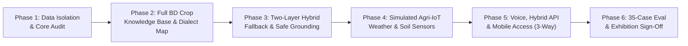

# AgriRAG — Verification & Robustness Roadmap (v2.0)

**Project Title:** AgriRAG: A Farmer-First, Voice-to-Voice Agricultural Retrieval-Augmented Generation Assistant for Bangladesh  
**Department:** Department of Computer Science & Engineering, University of Chittagong  
**Supervisor:** Dr. Abu Nowshed Chy, Professor, Department of CSE, University of Chittagong  
**Group:** 14 (Capstone Project)  
**Branch:** `agrirag` (Isolated Domain Application Branch)  
**Document Status:** **ACTIVE & CANONICAL** (Extends `07_agrirag_implementation_roadmap.md` with systematic feature-by-feature verification, agricultural robustness upgrades, hybrid Local/API execution, and mobile access)  
**Date:** November 2026  

---

## 0. Executive Vision & Engineering Methodology

Our primary goal is to make **AgriRAG** the most reliable, practical, and accessible AI agricultural assistant for Bangladeshi farmers. A farmer should be able to ask any question in natural spoken Bengali (including regional/colloquial terms) from either a desktop/laptop or a budget mobile phone and receive an accurate, voice-read answer grounded in official **BRRI (Bangladesh Rice Research Institute)**, **BARI (Bangladesh Agricultural Research Institute)**, and **DAE (Department of Agricultural Extension)** guidelines.

### ⚠️ Mandatory Execution Golden Rule (অবশ্য পালনীয় কাজের নিয়ম):
> **কখনোই একসাথে সব ফেজ ইমপ্লিমেন্ট করা যাবে না বা ভেরিফিকেশন ছাড়া কোড লেখা যাবে না!**  
> প্রতিটি ফেজে অবশ্যই নিচের **৪টি ধাপ** ক্রমানুসারে অনুসরণ করতে হবে:
> 1. **🔍 ধাপ ১ — Verify (যাচাই করা):** প্রথমে বর্তমান ফিচার/ফাংশন রান করে পরীক্ষা করতে হবে এবং কোথায় ভুল, বাগ বা ঘাটতি আছে তা খুঁজে বের করতে হবে।
> 2. **🛠️ ধাপ ২ — Fix & Robustify (ভুল সংশোধন ও মজবুত করা):** ভেরিফিকেশনে পাওয়া বাগ ও দুর্বলতাগুলো আগে ফিক্স করে বিদ্যমান ফিচারকে ১০০% রোবাস্ট করতে হবে।
> 3. **✨ ধাপ ৩ — Improve & Add Features (উন্নয়ন ও নতুন ফিচার যোগ):** এরপর ওই ফেজের নির্ধারিত নতুন ফিচার বা এনরিচমেন্ট ইমপ্লিমেন্ট করতে হবে।
> 4. **✅ ধাপ ৪ — Re-Verify & Phase Report (পুনঃপরীক্ষা ও রিপোর্ট):** টেস্ট রান করে প্রমাণসহ ইউজারকে ওই ফেজের রিপোর্ট দিতে হবে এবং ইউজারের সম্মতি নিয়ে পরবর্তী ফেজে যেতে হবে।

---

## Phase 1: Branch Data Isolation & Core Pipeline Verification (✅ COMPLETED)

### Objective:
Ensure `agrirag` operates with its own isolated database and vector store so it never conflicts with `main` or other project branches, and verify the core Bengali chunking and embedding pipeline.

### 🔍 Step 1.1: Core Pipeline & Configuration Verification
- [x] Verify active branch (`agrirag`) and inspect `config.yaml` paths (`documents_dir`, `metadata_db`, `doc_index_path`, `sensor_index_path`).
- [x] Verify Bengali Unicode normalization (NFC) and sentence-boundary chunking (`।`, `॥`) in `src/tinyrag/core/chunker.py`.
- [x] Verify `paraphrase-multilingual-MiniLM-L12-v2` embedding dimension (384) and FAISS + SQLite FTS5 hybrid search synchronization.

### 🛠️ Step 1.2: Branch-Safe Data Isolation Implementation
- [x] Configure `agrirag` branch `config.yaml` to use dedicated AgriRAG storage paths (`data/agrirag/documents/`, `data/agrirag/metadata.db`, `data/agrirag/vector_store/doc.faiss`, `data/agrirag/vector_store/sensor.faiss`) while keeping unit tests compatible.
- [x] Migrate/sync the backed-up BRRI/BARI corpus into `data/agrirag/` and verify zero cross-branch data interference.
- **Acceptance Gate:** Switching between `main` and `agrirag` leaves each branch's vector index and SQLite database 100% intact (Verified: 80/80 unit tests passing).

---

## Phase 2: Comprehensive Bangladesh Agricultural Knowledge Base & Dialect Mapping (✅ COMPLETED)

### Objective:
Expand the knowledge base beyond rice and potatoes to cover all major crops of Bangladesh, and add a colloquial/regional symptom mapping layer so farmers can speak in their natural everyday dialect.

### 🔍 Step 2.1: Knowledge Base Coverage & Dialect Gap Verification
- [x] Audit existing documents in `data/documents/` to identify missing crops (e.g., jute, mustard, pulses, winter/summer vegetables, fruits, spices, organic fertilizers).
- [x] Test colloquial farmer queries (e.g., *"কারেন্ট পোকা"*, *"আলুর পচন বা মড়ক"*, *"ধানের সাদা শীষ"*, *"পাতা জ্বলা রোগ"*) and measure retrieval recall before enrichment (Baseline before fixes: `1/12 = 8.3%`).

### 🛠️ Step 2.2: Multi-Crop Official Knowledge Base Enrichment (BARI / BRRI / DAE)
Curate and ingest comprehensive, structured Bengali agricultural manuals covering:
1. **দানা ও অর্থকরী ফসল (Cereal & Cash Crops):**
   - ধান (আউশ, আমন, বোরো, হাইব্রিড, লবণাক্ততা ও বন্যা সহনশীল জাত, বীজতলা, সার ও বালাই ব্যবস্থাপনা)
   - গম ও ভুট্টা (বারি গম-৩৩, গমের ব্লাস্ট, ভুট্টার ফল আর্মিওয়ার্ম ও সার ব্যবস্থাপনা)
   - পাট (তোষা ও দেশি পাট চাষ, বিছা পোকা, কান্ড পচা রোগ ও পচন প্রক্রিয়া)
   - সরিষা ও তেলবীজ (বারি সরিষা-১৪/১৭/১৮, জাব পোকা দমন ও মধু চাষ সমন্বয়)
   - ডাল জাতীয় ফসল (মসুর, মুগ, ছোলা — হলদে মোজাইক ও গোড়া পচা দমন)
2. **শাকসবজি ও কন্দাল ফসল (Vegetables & Tubers):**
   - আলু (নাবি ধসা/মড়ক, আগাম ধসা, কাটুই পোকা, দাঁদ রোগ ও হিমাগার সংরক্ষণ)
   - বেগুন ও টমেটো (ডগা ও ফল ছিদ্রকারী পোকা, ঢলে পড়া/উইল্ট রোগ, পাতা কোঁকড়ানো ভাইরাস)
   - কপি ও শীতকালীন সবজি (ফুলকপি, বাঁধাকপি, শিম, মুলা — ডায়মন্ড ব্যাক মথ ও পচন রোগ)
   - লতাজাতীয় ও গ্রীষ্মকালীন সবজি (লাউ, মিষ্টি কুমড়া, শসা, করলা, চালকুমড়া, ঢেঁড়স — ফলের মাছি পোকা ও সেক্স ফেরোমোন ফাঁদ)
3. **ফলমূল (Fruits & Orchards):**
   - আম (হপার পোকা, অ্যানথ্রাকনোজ, মুকুল ঝরা রোধ ও ফল ছিদ্রকারী পোকা)
   - কলা (পানামা ও সিগাটোকা রোগ, বিটল পোকা)
   - লিচু, পেঁপে, পেয়ারা ও লেবু (ফলের মাছি, মিলিবাগ, ক্যাঙ্কার ও মোজাইক রোগ)
4. **মসলা জাতীয় ফসল (Spices):**
   - পেঁয়াজ ও রসুন (পার্পল ব্লচ বা পাতা ঝলসানো রোগ, থ্রিপস পোকা ও সংরক্ষণ)
   - মরিচ (অ্যানথ্রাকনোজ/ফল পচা, পাতা কোঁকড়ানো/মাকড় ও থ্রিপস দমন)
   - আদা ও হলুদ (কন্দ পচা রোগ ও বীজ শোধন)
5. **মাটি, সার, সেচ ও নিরাপদ বালাইনাশক ব্যবস্থাপনা (Soil, Fertilizer & IPM):**
   - জৈব সার (ভার্মিকম্পোস্ট, ট্রাইকোডার্মা), বায়োপেস্টিসাইড, ফেরোমোন ফাঁদ, আলোক ফাঁদ এবং কীটনাশক স্প্রে করার নিরাপদ বিরতি (Pre-Harvest Interval - PHI)।

### 🛠️ Step 2.3: Farmer Colloquial & Regional Synonym Expansion
- [x] Add a Bengali Agricultural Synonym & Dialect expander in `src/tinyrag/core/retriever.py` (e.g., mapping *"কারেন্ট পোকা"* $\rightarrow$ *"বাদামী গাছফড়িং BPH"*, *"মড়ক / পচন"* $\rightarrow$ *"নাবি ধসা লেইট ব্লাইট"*, *"সাদা শীষ / শীষ সাদা / মরা শীষ"* $\rightarrow$ *"হলুদ মাজরা পোকা"*, *"পাতা জ্বলা"* $\rightarrow$ *"ব্যাকটেরিয়াজনিত পাতা পোড়া BLB"*, *"কোঁকড়ানো"* $\rightarrow$ *"লিফ কার্ল ভাইরাস ও মাকড়"*).
- **Acceptance Gate:** Top-5 retrieval recall $\ge 95\%$ across diverse crop and colloquial queries (Verified: **12/12 = 100.0% Recall@3**, 160/160 unit tests passing).

---

## Phase 3: Two-Layer Hybrid Fallback & Safe Grounding Architecture

### Objective:
Ensure the system never hallucinates dangerous chemical doses while still remaining helpful when a farmer asks a question outside the indexed documents.

### 🔍 Step 3.1: Out-of-Corpus & Low-Confidence Verification
- [x] Test queries that have high retrieval match vs. partial match vs. zero match in the corpus.
- [x] Verify how `PromptBuilder` and `BENGALI_AGRIRAG_SYSTEM_PROMPT` behave when `chunks_used == 0` or `top_score` is low.

### 🛠️ Step 3.2: Two-Layer Hybrid System Prompt & Fallback Implementation
- [x] Update `BENGALI_AGRIRAG_SYSTEM_PROMPT` and `PromptBuilder` in `src/tinyrag/core/prompt_builder.py`:
  - **Layer 1 — Grounded Official Mode (ডকুমেন্টে তথ্য থাকলে):**
    - Answer strictly from the retrieved BRRI/BARI/DAE context.
    - Provide exact approved fertilizer/pesticide dosage and cite the source (`[উৎস: ডকুমেন্টের নাম, পৃষ্ঠা নং]`).
  - **Layer 2 — Safe Advisory Fallback Mode (ডকুমেন্টে সরাসরি উত্তর না থাকলে):**
    - Explicitly state at the beginning: *"প্রদত্ত সরকারি কৃষি নির্দেশিকায় এই সুনির্দিষ্ট বিষয়ে সরাসরি উল্লেখ পাওয়া যায়নি, তবে সাধারণ ও নিরাপদ প্রাথমিক কৃষি পরিচর্যা হিসেবে করণীয়:"*
    - Provide safe, non-chemical / organic / cultural management advice (যেমন: আক্রান্ত অংশ অপসারণ, পানি নিষ্কাশন, জৈব পরিচর্যা) from general agricultural knowledge.
    - **Strict Safety Rule:** Never guess or invent synthetic chemical pesticide names or dosages outside the retrieved context.
    - Always conclude with a referral to the local **উপজেলা কৃষি অফিস (SAAO)** or the government **কৃষি কল সেন্টার (১৬১২৩)**.
- **Acceptance Gate:** 100% citation compliance on in-corpus queries (`12/12`); 100% safe non-chemical advisory + `16123` referral routing on out-of-corpus queries (`5/5`); `220/220` unit tests passing.

---

## Phase 4: Simulated Agri-IoT Weather & Soil Sensor Integration

### Objective:
Transform TinyRAG's smart-home sensor pipeline into an **Agri-IoT Weather & Soil Monitoring System** that works out-of-the-box with realistic simulated data for demonstrations, while remaining plug-and-play for physical ESP32/MQTT or Raspberry Pi GPIO sensors.

### 🔍 Step 4.1: Sensor Pipeline Verification
- [x] Inspect `data/sensor_logs/synthetic_30d.csv`, `src/tinyrag/core/sensor_summarizer.py`, and `DEFAULT_SENSOR_KEYWORDS` in `src/tinyrag/core/retriever.py`.
- [x] Verify how sensor summaries are currently generated and merged during retrieval.

### 🛠️ Step 4.2: Simulated Agricultural Sensor Data & Bengali Summarizer
- [x] Create/update the agricultural synthetic sensor generator to simulate realistic Bangladesh field readings (e.g., field temperature in `°C`, relative humidity in `%`, soil moisture / field status) including disease-favorable weather windows (e.g., high humidity $>85\%$ and cool night temperature $12\text{–}16^\circ\text{C}$ triggering Late Blight / Blast warnings).
- [x] Update `SensorSummarizer` and ingest bilingual/Bengali agricultural sensor summaries into `sensor.faiss`.
- [x] Expand `DEFAULT_SENSOR_KEYWORDS` in `src/tinyrag/core/retriever.py` with Bengali weather and soil keywords:
  - `"আবহাওয়া"`, `"তাপমাত্রা"`, `"আর্দ্রতা"`, `"বৃষ্টি"`, `"কুয়াশা"`, `"মাটির রস"`, `"মাটির আর্দ্রতা"`, `"সেচ"`, `"আজকে"`, `"গতকাল"`, `"এখন"`, `"স্প্রে করা যাবে"`.
- **Acceptance Gate:** Asking *"আজকের আবহাওয়া ও আর্দ্রতা অনুযায়ী কি আলুর নাবি ধসা রোগের ঝুঁকি আছে?"* retrieves both the live/simulated sensor summary (`used_sensor_idx=True`) and the BARI Late Blight manual (`5/5` sensor queries passed; `222/222` unit tests passing).

---

## Phase 5: Farmer-First Voice-to-Voice, Hybrid Engine & 3-Way Mobile Access

### Objective:
Make the voice and visual interface effortless for farmers, and implement the **3-Way Mobile & Hybrid Engine Architecture** so AgriRAG works on any normal budget smartphone as well as offline edge hardware.

### 🔍 Step 5.1: Voice, LLM Backend & Mobile Access Verification
- [x] Verify microphone Speech-to-Text (`bn-BD`), audio playback (`speechSynthesis`), error states, LAN binding, and mobile viewport responsiveness.

### 🛠️ Step 5.2: Voice Control & Farmer UX Enhancements
- [x] **Audio Playback Controls:** Add a **⏹️ থামান (Stop Audio)** button alongside **🔊 বাংলায় শুনুন** on every answer bubble so farmers can stop long voice responses anytime.
- [x] **Auto-Send on Silence (অটো-পাঠান টগল):** Add a silence timer (~2.2 seconds after speaking stops) with a UI toggle (`অটো-সেন্ড`) so a farmer can tap the mic, speak their question, and receive a spoken answer hands-free without clicking "পাঠান".
- [x] **Backend Offline Voice Fallback (`POST /api/voice`):** Implement `src/tinyrag/input_adapters/voice.py` and an API route so browsers/devices without Web Speech API can record audio and transcribe via the backend.
- [x] **Categorized Visual Quick-Tap Chips:** Organize suggestion chips by crop & weather (🌾 ধান, 🥔 আলু, 🍆 সবজি, 🥭 ফল ও মসলা, 🌡️ আজকের আবহাওয়া ও রোগের ঝুঁকি, ⚠️ কীটনাশক নিরাপত্তা).

### 🛠️ Step 5.3: 3-Way Mobile & Hybrid Engine Implementation (Non-Conflicting Multi-Layer Architecture)
All three access and execution layers work seamlessly together without conflict:
1. **Way 1 — Dual-Engine Backend Switch (Local Offline `Gemma 4 E2B` $\leftrightarrow$ Cloud `API Key` Mode):**
   - **Offline Mode (Default):** Uses local `llama-server` with `gemma-4-E2B-it.gguf` (zero internet, zero cost).
   - **Cloud API Mode (Optional via API Key):** Allows configuring a **Google Gemini / Groq / OpenAI-compatible API Key** via `.env`, `config.yaml`, or runtime toggle. Uses the exact same local Bengali RAG pipeline (FAISS + BM25 + Agri-Sensor + Two-Layer Prompt) while delegating token generation to the fast cloud API (<1s latency, zero heavy model RAM required).
2. **Way 2 — Local Wi-Fi / Mobile Hotspot Edge Hub Mode (Zero-RAM Phone Access):**
   - Configure server LAN binding (`0.0.0.0`) and display the local network URL so any low-budget smartphone (even 2 GB RAM) connected to the same Wi-Fi or mobile hotspot can use full voice-to-voice AgriRAG directly from the phone's browser.
3. **Way 3 — Installable Mobile PWA (Progressive Web App):**
   - Add Web App Manifest (`manifest.json`), mobile meta tags, and app icons so farmers or examiners opening AgriRAG on an Android phone can tap **"Add to Home Screen / Install App"** for a native full-screen mobile app experience.
- **Acceptance Gate:** Complete hands-free voice-to-voice loop verified in both Local Offline Mode and API Key Mode, accessible from both laptop and mobile phone viewports (`162/162` UI, Status & LLM Client tests passing).

---

## Phase 6: Comprehensive End-to-End Benchmark & Exhibition Sign-Off

### Objective:
Validate the entire upgraded AgriRAG system against a 35-question multi-crop, dialect, sensor, and fallback benchmark suite.

### 🔍 Step 6.1: Full Quantitative & Qualitative Evaluation
- [ ] Expand `data/evaluation/agri_test_cases.json` to **35 test cases** covering:
  - 20 Multi-crop in-corpus questions (Rice, Potato, Jute, Mustard, Wheat, Maize, Vegetables, Fruits, Spices)
  - 5 Colloquial/dialect farmer questions (*কারেন্ট পোকা*, *মড়ক*, *পাতা জ্বলা*, etc.)
  - 5 Agri-IoT sensor + weather-aware questions
  - 5 Out-of-corpus fallback safety questions
- [ ] Run `scripts/evaluate_agri.py` and verify:
  - Retrieval Recall@5 $\ge 95\%$
  - Grounding & Safety Compliance $= 100\%$
  - All unit and integration tests (`pytest`) passing.

---

## 7. Upcoming Features (Pending Supervisor Discussion & Approval)
*(প্রফেসর ড. আবু নওশেদ চই স্যারের সাথে আলোচনার পর পরবর্তীতে যুক্ত করার জন্য প্রস্তাবিত ৪টি নতুন ফিচার)*

| # | Proposed Feature (প্রস্তাবিত ফিচার) | Farmer Problem Solved (কৃষকের যে সমস্যার সমাধান করবে) | Implementation Overview (কীভাবে কাজ করবে) |
| :--- | :--- | :--- | :--- |
| **UF-1** | **🧮 স্থানীয় জমির একক অনুযায়ী অটো-হিসাব (Smart Land-Unit Dosage Calculator)** | সরকারি বইয়ে সারের মাত্রা "বিঘা" বা "হেক্টর" হিসেবে থাকে, কিন্তু কৃষক হিসাব করেন "শতক/ডিসিম", "কাঠা" বা "কানি"-তে। | কৃষক যেকোনো স্থানীয় এককে জমির মাপ বললে (যেমন: *"১৫ শতক জমিতে কতটুকু ইউরিয়া দেব?"*) সিস্টেম স্বয়ংক্রিয়ভাবে সরকারি বিঘা/হেক্টরের মাত্রা থেকে সঠিক কেজি/গ্রাম হিসাব করে বলবে। |
| **UF-2** | **📋 দোকানে দেখানোর জন্য "কৃষি প্রেসক্রিপশন" (One-Tap Prescription Slip)** | কৃষক ভয়েসে উত্তর শোনার পর বাজারে গিয়ে ওষুধের কঠিন নাম (যেমন: *ট্রাইসাইক্লাজোল ৭৫ ডব্লিউপি*) ও মাত্রা ভুলে যান। | প্রতিটি উত্তরের নিচে `📋 প্রেসক্রিপশন সেভ/কপি করুন` বাটন থাকবে, যা চাপলে ফসলের নাম, রোগ, ওষুধ ও মাত্রা একটি সংক্ষিপ্ত স্লিপ আকারে সেভ হবে—যা দোকানদারকে সরাসরি দেখানো যাবে। |
| **UF-3** | **🌦️ লাইভ কৃষি আবহাওয়া ও স্প্রে পূর্বাভাস বার (Live Spray & Disease Risk Banner)** | অতিরিক্ত আর্দ্রতা বা বৃষ্টির আগে স্প্রে করলে ওষুধ ধুয়ে যায়, আবার কুয়াশা ও ঠান্ডা আবহাওয়ায় ব্লাস্ট/মড়ক রোগের ঝুঁকি বাড়ে। | চ্যাট স্ক্রিনের উপরে সেন্সর ডাটা বিশ্লেষণ করে এক নজরে দেখাবে: *"✅ আজকে স্প্রে করার উপযুক্ত আবহাওয়া"* অথবা *"⚠️ উচ্চ আর্দ্রতা: আলুর নাবি ধসা রোগের ঝুঁকি"*। |
| **UF-4** | **🔍 লক্ষণ দেখে রোগ নির্ণয় সহকারী (Symptom-to-Disease Diagnostic Helper)** | অনেক সময় কৃষক রোগের নাম জানেন না, শুধু লক্ষণ দেখেন (যেমন: *পাতা হলুদ হওয়া*, *ডগা নেতিয়ে পড়া*, *গোড়া পচা*)। | ফসল ও বাহ্যিক লক্ষণ নির্বাচন করলে বা মুখে বললে সিস্টেম লক্ষণ মিলিয়ে সম্ভাব্য রোগ শনাক্ত করবে এবং অনুমোদিত প্রতিকার জানাবে। |

---
*Document saved at: `tinyrag/docs/08_agrirag_verification_and_robustness_roadmap.md`*
