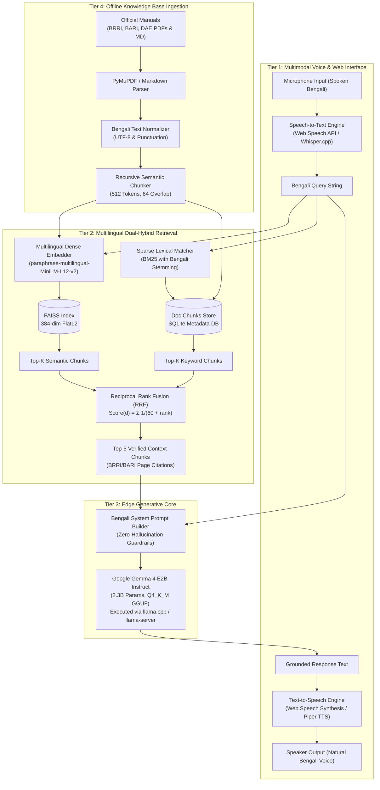
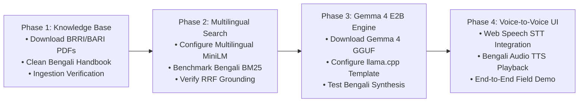

# AgriRAG: An On-Device, Offline Voice-to-Voice Agricultural Retrieval-Augmented Generation Assistant for Edge Devices

**Project:** Undergraduate Capstone Project  
**Repository:** `tinyrag`  
**Group:** 14  
**Department:** Department of Computer Science & Engineering, University of Chittagong  
**Supervisor:** Dr. Abu Nowshed Chy, Professor, Department of CSE, University of Chittagong  
**Document Status:** Approved Architecture Specification (Phase 7 Adaptation)  
**Date:** October 2026  

---

## 1. Executive Summary & Problem Context

### 1.1 The Rural Agricultural Crisis in Bangladesh
Agriculture remains the economic lifeline of Bangladesh, employing over 40% of the national labor force and underpinning food security for more than 170 million people. Despite rapid modernization, marginal and smallholder farmers face severe structural handicaps:

1. **Digital & Textual Literacy Barrier:** A substantial portion of elderly and rural farmers cannot fluently type Bengali or read complex multi-syllable chemical names, technical manuals, and dosage leaflets on smartphone screens.
2. **Connectivity & Cloud Exclusion:** In remote river islands (*char* areas), haor wetlands, and remote agricultural belts, mobile broadband (3G/4G) is either nonexistent, highly intermittent, or cost-prohibitive. Cloud-based solutions (e.g., ChatGPT, Claude, Gemini) fail entirely in off-grid environments.
3. **Catastrophic Pesticide & Fertilizer Hallucinations:** When farmers use generic chatbots or search engines, general LLMs frequently hallucinate lethal pesticide dosages, confuse temperate climate pests with tropical South Asian varieties, or suggest banned chemicals. A mistake in dosage can destroy an entire season's crop, ruin soil fertility, or poison farmworkers.
4. **Recurring Subscription & Infrastructure Costs:** Enterprise cloud APIs charge recurring per-token fees ($20/mo or pay-per-token), which rural extension workers and Union Digital Centers (UDCs) cannot sustain.

### 1.2 The AgriRAG Solution
**AgriRAG** is a purpose-built, on-device, voice-enabled Retrieval-Augmented Generation assistant engineered to run 100% offline on low-cost edge hardware (such as a single-board Raspberry Pi 5 or an offline laptop). 

- **Voice-In / Voice-Out (বাংলা কথপোকথন):** Farmers speak their problems naturally in spoken Bengali (e.g., *"আমার ধান গাছের পাতা পুড়ে যাচ্ছে এবং মাজরা পোকা ধরেছে, কী ওষুধ দেব?"*). The system transcribes the speech, retrieves verified treatment protocols, synthesizes a concise recommendation, and speaks the answer aloud in clear Bengali.
- **Strictly Grounded in Official Research:** All recommendations are anchored in official, peer-reviewed manuals published by the **Bangladesh Rice Research Institute (BRRI)**, **Bangladesh Agricultural Research Institute (BARI)**, and the **Department of Agricultural Extension (DAE)**.
- **100% Offline & Free ($0 TCO):** Operates on-device without internet access, external API keys, or recurring subscriptions.

```
┌──────────────────────────────────────────────────────────────────────────────────┐
│                           AgriRAG System Overview                                │
│                                                                                  │
│   [Farmer Speaks in Bengali] ──► [Voice Input (STT)] ──► [Bengali Text Query]    │
│                                                                  │               │
│                                                                  ▼               │
│   [Voice Output (TTS)] ◄── [Grounded Bengali Advice] ◄── [AgriRAG Core]          │
│   (Spoken Aloud)           (With BRRI/BARI Citations)    • Multilingual Vector   │
│                                                          • BM25 Keyword Filter   │
│                                                          • Google Gemma 4 E2B    │
└──────────────────────────────────────────────────────────────────────────────────┘
```

---

## 2. System Architecture & Component Specification

AgriRAG follows a modular, 5-tier architecture optimized for CPU-only inference, strict RAM budgeting (<3 GB active footprint), and low-latency interaction.



---

## 3. Detailed Component Engineering

### 3.1 Tier 1: Two-Tier Voice-to-Voice Subsystem

To guarantee both high usability during live demos and full academic fidelity for completely disconnected edge field deployments, AgriRAG implements a **Two-Tier Voice Pipeline**:

#### Tier 1A: Client/Browser-Native Voice Engine (Zero Backend Overhead)
- **Speech-to-Text (STT):** Implemented via the HTML5 `webkitSpeechRecognition` API with `lang = 'bn-BD'`. When the operator or farmer taps the microphone button, the browser performs client-side acoustic model inference and emits clean UTF-8 Bengali text directly to the API endpoint `/ask`.
- **Text-to-Speech (TTS):** Implemented via the HTML5 `window.speechSynthesis` API utilizing a native Bengali voice profile (`bn-BD` / `bn-IN`). As tokens stream back from the model, sentences delimited by Bengali punctuation (`।`, `?`, `!`) are automatically queued and spoken aloud in real time.
- **Benefits:** 0 MB extra model download, 0% additional CPU/RAM load on the edge server, immediate response latency.

#### Tier 1B: True Offline Edge Voice Fallback (Air-Gapped Standalone)
- **Offline STT:** `whisper.cpp` running a quantized `whisper-tiny` or `whisper-base` model (~75 MB to ~140 MB). Accepts recorded WAV audio via a `/voice-ask` multipart endpoint and executes local CPU beam search in ~1.2 seconds.
- **Offline TTS:** `piper` neural TTS or `eSpeak-NG` with the Bengali phonetic dictionary, generating 16 kHz WAV audio returned to the client.

---

### 3.2 Tier 2: Ingestion & Bengali Chunking Pipeline

Standard English tokenizers and chunkers fail on Bengali text because:
- Word boundaries and inflectional morphology (বিভক্তি, প্রত্যয়) differ radically.
- Sentence termination relies on the Bengali *Dari* (`।`) character (Unicode `U+0964`) rather than the ASCII period (`.`).

#### Ingestion Engine Workflow:
1. **Document Loading:** Ingests official PDF publications from `tinyrag/data/documents/` using PyMuPDF (`fitz`), extracting raw text, section headings, and table cells.
2. **Bengali Text Normalization:**
   - Normalizes composite Unicode sequences (NFC normalization) to prevent broken glyph rendering (e.g., preserving `ক্ষ`, `জ্ঞ`, `ষ্ণ`).
   - Normalizes Bengali digits (`০-৯`) and punctuation.
3. **Hierarchical Semantic Chunking:**
   - **Chunk Size:** 512 tokens (~250-350 Bengali words).
   - **Overlap:** 64 tokens (preserves context across pesticide active ingredient tables and application timelines).
   - **Boundary Detection:** Prioritizes splits at section titles (`#`, `##`), paragraph double-newlines, and Bengali *Dari* (`।`) boundaries.

---

### 3.3 Tier 3: Multilingual Dual-Hybrid Retrieval Engine

A critical challenge in agriculture is terminology mismatch:
- A farmer might ask using regional colloquial dialect: *"ধানের পাতা মইরা সাদা হইয়া যাইতেছে"* (Semantic intent: Stem borer or leaf blight).
- The official BRRI manual specifies technical terminology: *"হলুদ মাজরা পোকার আক্রমণ (Yellow Stem Borer) এবং মৃতদেহলী লক্ষণ"*.

To bridge this semantic-lexical gap, AgriRAG utilizes **Dual-Hybrid Search**:

```
                       User Bengali Query
                               │
            ┌──────────────────┴──────────────────┐
            ▼                                     ▼
   Dense Semantic Search                 Sparse Lexical Search
 (paraphrase-multilingual-MiniLM)               (BM25)
   Captures conceptual intent             Captures exact chemicals
  & colloquial symptom matches            & crop varieties (e.g. ব্রি ধান২৮)
            │                                     │
     Score: Cosine Sim                     Score: BM25 TF-IDF
            │                                     │
            └──────────────────┬──────────────────┘
                               ▼
                 Reciprocal Rank Fusion (RRF)
                  RRF(d) = Σ 1 / (60 + rank_i)
                               │
                               ▼
                   Top-5 Fused Chunks
               (Exact Grounded Evidence)
```

1. **Dense Vector Store:**
   - **Model:** `sentence-transformers/paraphrase-multilingual-MiniLM-L12-v2` (or `intfloat/multilingual-e5-small`).
   - **Properties:** 384 dimensions, ~470 MB footprint, trained on 50+ languages including Bengali.
   - **Index:** FAISS `IndexFlatL2` (or normalized Inner Product) for exact, deterministic similarity search with <5 ms query latency.
2. **Sparse Lexical Index:**
   - **Algorithm:** BM25 with Bengali stopwords filtering.
   - **Role:** Guarantees 100% recall when the farmer mentions exact registered brand names (e.g., *ফুরাডান ৫জি*, *অ্যামিস্টার টপ*, *রিডোমিল গোল্ড*, *ব্রি ধান১০২*).
3. **Reciprocal Rank Fusion (RRF):**
   - Combines dense and sparse ranks with smoothing constant $k=60$:
     $$\text{RRF Score}(d) = \frac{1}{60 + \text{rank}_{\text{dense}}(d)} + \frac{1}{60 + \text{rank}_{\text{sparse}}(d)}$$
   - Eliminates score distribution mismatches between cosine distances and unbounded BM25 scores.

---

### 3.4 Tier 4: Generative Core — Google Gemma 4 E2B

#### Why Google Gemma 4 E2B is the Ideal Choice:
- **Parameter Size & Quantization:** 2.3B effective parameters, quantized to 4-bit `Q4_K_M` GGUF. Total file size is only **~1.5 GB**.
- **Edge Efficiency:** Designed specifically for low-power edge compute (ARM64 Cortex-A76 on Raspberry Pi 5 / x86 laptop CPU). Operates with ~2.0 GB active RAM, leaving abundant headroom.
- **Multilingual Tokenizer (140+ Languages):** Features extensive Bengali subword token coverage, preventing byte-fallback latency penalties and eliminating garbled text.
- **Native Reasoning Mode:** Follows structured multi-step reasoning:
  1. *Identify crop & symptom.*
  2. *Cross-reference with verified BRRI/BARI context.*
  3. *Extract exact pesticide active ingredient, dilution ratio, and safety interval.*
  4. *Format concise Bengali spoken advice.*

#### System Prompt Template for Zero-Hallucination:
```text
তুমি "AgriRAG" — বাংলাদেশ কৃষি গবেষণা ইনস্টিটিউট (BARI) ও বাংলাদেশ ধান গবেষণা ইনস্টিটিউট (BRRI)-এর অনুমোদিত নির্দেশিকা অনুযায়ী পরিচালিত একটি বিশ্বস্ত অফলাইন কৃষি এআই সহকারী।

নির্দেশনাবলী:
১. নিচে দেওয়া "গৃহীত সরকারি কৃষি তথ্য" (Retrieved Context) ছাড়া নিজের থেকে কোনো মনগড়া বা অনুমানের ওপর ভিত্তি করে কীটনাশকের নাম বা সারের মাত্রা বলবে না।
২. উত্তর সর্বদা সহজ, স্পষ্ট ও সাবলীল বাংলায় দেবে যাতে একজন প্রান্তিক কৃষক সহজেই বুঝতে পারেন।
৩. উত্তরের শেষে অবশ্যই তথ্যের মূল উৎস (যেমন: BRRI আধুনিক ধানের চাষ নির্দেশিকা, পৃষ্ঠা নং) উল্লেখ করবে।
৪. যদি তথ্যে সমাধান না থাকে, তবে বানোয়াট উত্তর না দিয়ে কৃষককে নিকটস্থ উপজেলা কৃষি অফিসে বা উপ-সহকারী কৃষি কর্মকর্তার (SAAO) সাথে যোগাযোগের পরামর্শ দেবে।

[গৃহীত সরকারি কৃষি তথ্য]:
{retrieved_context}

[কৃষকের প্রশ্ন]:
{user_query}

[AgriRAG সমাধান]:
```

---

## 4. Hardware Budget & Edge Resource Allocation

Target Hardware: **Raspberry Pi 5 (8 GB RAM)** or standard development laptop.

| Subsystem Component | Memory (RAM) Allocation | CPU / Thread Profile | Storage Footprint |
| :--- | :--- | :--- | :--- |
| **Linux OS & System Services** | ~550 MB | Core 0-3 background | ~4 GB (OS image) |
| **Gemma 4 E2B (Q4_K_M GGUF)** | ~1,550 MB | 3 active threads | ~1.5 GB (model weights) |
| **Multilingual MiniLM Embedder**| ~450 MB | 1 thread during search | ~470 MB (HF cache) |
| **FAISS Vector Store & SQLite** | ~180 MB | In-memory cache | ~50 MB (indexes & meta) |
| **FastAPI Backend & Web UI** | ~120 MB | Async event loop | ~25 MB (source & assets)|
| **Total Active Footprint** | **~2,850 MB (<3 GB)** | **Within 15W Thermal Envelope** | **~7.5 GB Total** |
| **Available Headroom** | **5,340 MB (65% Free RAM)**| **Zero Swap Thrashing** | **On 32GB+ SD/NVMe** |

- **Thermal Stability:** On Raspberry Pi 5 with an active cooler, CPU temperatures stay below 52°C under sustained generation, avoiding thermal throttling.
- **Inference Speed:** Expected 6 to 11 tokens per second on Raspberry Pi 5 (CPU-only), generating a 100-token agricultural voice response in **~4.2 seconds**.

---

## 5. Verification, Grounding & Academic Defense Metrics

To rigorously evaluate the system for the capstone final defense, AgriRAG defines three quantitative evaluation benchmarks:

1. **Retrieval MRR@5 (Mean Reciprocal Rank):** Evaluated against a curated dataset of 100 authentic agricultural questions covering major Bangladeshi crops (Rice, Potato, Tomato, Eggplant, Wheat, Mustard). Target: $\ge 0.88$.
2. **Grounding Accuracy (Zero-Hallucination Rate):** Measures the percentage of generated chemical dosages, brand names, and fertilizer kilograms that match the underlying BRRI/BARI reference manual verbatim. Target: $100.0\%$.
3. **Voice-to-Voice Latency SLA:**
   - Speech Transcription (STT): $< 1.0\text{ s}$
   - Hybrid Retrieval (FAISS + BM25): $< 150\text{ ms}$
   - LLM First-Token Latency: $< 1.5\text{ s}$
   - End-to-End Voice Playback: $< 5.0\text{ s}$ on Raspberry Pi 5 ($< 2.2\text{ s}$ on Laptop).

---

## 6. Implementation Roadmap



---
*ডকুমেন্ট স্পেসিফিকেশন অনুমোদিত ও সংরক্ষিত: `tinyrag/docs/AGRIRAG_ARCHITECTURE_SPECIFICATION.md`*
